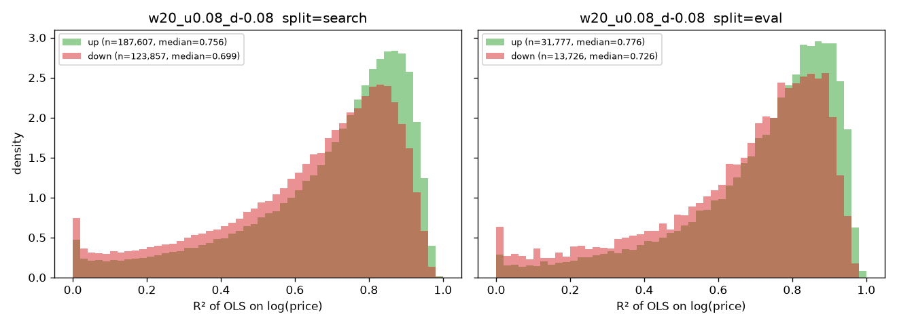
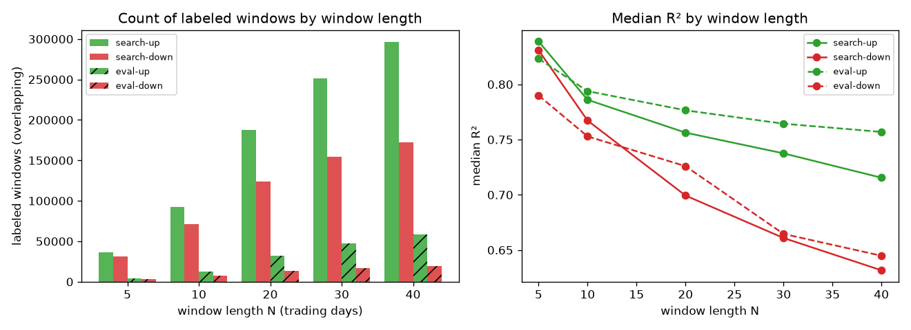
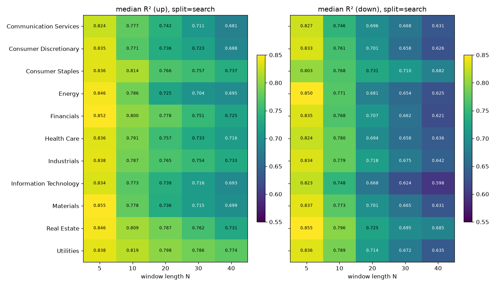
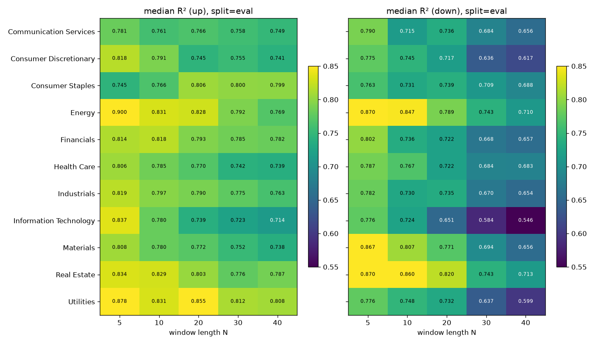
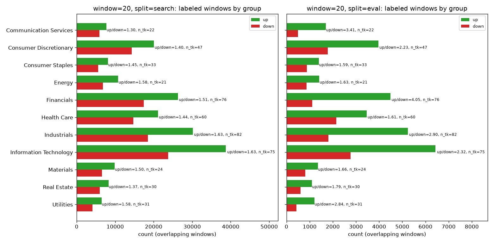

# S&P 500 线性趋势扫描 —— 实验报告（自动生成）

> 本报告所有数字均由 `experiments/index.csv` 与实验目录自动读取生成。
> 检测到的上涨/下跌区间是**事后（ex-post）描述**，使用了窗口内的未来价格，不是可执行的交易信号。

- 运行时间戳：`20261026T143140`
- 数据区间：2016-01-04 ~ 2026-10-23，参与扫描股票数 501
- 时间切分：随机块切分，块单位 `year`，seed=42，search 块 9 / 共 11
- search 年份：2016, 2018, 2019, 2020, 2021, 2022, 2023, 2025, 2026
- eval 年份：2017, 2024

## 运行信息

- load_seconds：1.3
- scan_fit_total_seconds：9.1
- data/raw 磁盘占用：191M
- data/processed 磁盘占用：144M

## 各参数组合汇总（search / eval / excluded）

| window | split | label | n_windows_total | count | share_of_windows | n_tickers | cum_return_median | slope_median | slope_annual_median | r2_q25 | r2_q50 | r2_q75 | share_r2_ge_0.8 | resid_std_median | max_abs_resid_median |
|---|---|---|---|---|---|---|---|---|---|---|---|---|---|---|---|
| 5 | all | up | 1,318,583 | 40,404 | 0.0306 | 501 | 0.1053 | 0.0254 | 6.4089 | 0.7085 | 0.8373 | 0.9184 | 0.5890 | 0.0219 | 0.0262 |
| 5 | all | down | 1,318,583 | 34,596 | 0.0262 | 501 | -0.1046 | -0.0281 | -7.0854 | 0.6970 | 0.8279 | 0.9151 | 0.5667 | 0.0248 | 0.0296 |
| 5 | search | up | 1,071,121 | 36,023 | 0.0336 | 501 | 0.1057 | 0.0255 | 6.4304 | 0.7103 | 0.8389 | 0.9196 | 0.5925 | 0.0219 | 0.0261 |
| 5 | search | down | 1,071,121 | 31,647 | 0.0295 | 501 | -0.1049 | -0.0282 | -7.1100 | 0.7011 | 0.8309 | 0.9171 | 0.5744 | 0.0246 | 0.0294 |
| 5 | eval | up | 239,726 | 4,285 | 0.0179 | 397 | 0.1030 | 0.0248 | 6.2601 | 0.6933 | 0.8233 | 0.9088 | 0.5585 | 0.0224 | 0.0268 |
| 5 | eval | down | 239,726 | 2,873 | 0.0120 | 358 | -0.1017 | -0.0272 | -6.8636 | 0.6610 | 0.7899 | 0.8846 | 0.4775 | 0.0272 | 0.0324 |
| 5 | excluded | up | 7,736 | 96 | 0.0124 | 52 | 0.0968 | 0.0246 | 6.1869 | 0.7767 | 0.8682 | 0.9182 | 0.6667 | 0.0197 | 0.0224 |
| 5 | excluded | down | 7,736 | 76 | 0.0098 | 34 | -0.0939 | -0.0268 | -6.7519 | 0.8086 | 0.8769 | 0.9357 | 0.7500 | 0.0192 | 0.0223 |
| 10 | all | up | 1,316,078 | 106,040 | 0.0806 | 501 | 0.1094 | 0.0117 | 2.9591 | 0.6394 | 0.7873 | 0.8773 | 0.4692 | 0.0208 | 0.0349 |
| 10 | all | down | 1,316,078 | 78,363 | 0.0595 | 501 | -0.1090 | -0.0132 | -3.3282 | 0.6108 | 0.7657 | 0.8619 | 0.4191 | 0.0251 | 0.0420 |
| 10 | search | up | 1,063,796 | 92,533 | 0.0870 | 501 | 0.1099 | 0.0118 | 2.9724 | 0.6369 | 0.7860 | 0.8763 | 0.4664 | 0.0210 | 0.0352 |
| 10 | search | down | 1,063,796 | 70,863 | 0.0666 | 501 | -0.1096 | -0.0133 | -3.3459 | 0.6124 | 0.7672 | 0.8627 | 0.4226 | 0.0252 | 0.0420 |
| 10 | eval | up | 234,876 | 12,838 | 0.0547 | 478 | 0.1060 | 0.0115 | 2.8925 | 0.6549 | 0.7939 | 0.8834 | 0.4846 | 0.0199 | 0.0333 |
| 10 | eval | down | 234,876 | 7,215 | 0.0307 | 435 | -0.1040 | -0.0126 | -3.1697 | 0.5974 | 0.7529 | 0.8539 | 0.3839 | 0.0248 | 0.0414 |
| 10 | excluded | up | 17,406 | 669 | 0.0384 | 175 | 0.1035 | 0.0106 | 2.6800 | 0.6778 | 0.8224 | 0.8955 | 0.5590 | 0.0165 | 0.0274 |
| 10 | excluded | down | 17,406 | 285 | 0.0164 | 98 | -0.1010 | -0.0121 | -3.0442 | 0.6087 | 0.7627 | 0.8644 | 0.4211 | 0.0220 | 0.0373 |
| 20 | all | up | 1,311,068 | 224,667 | 0.1714 | 500 | 0.1187 | 0.0061 | 1.5281 | 0.5918 | 0.7600 | 0.8578 | 0.4077 | 0.0221 | 0.0449 |
| 20 | all | down | 1,311,068 | 139,492 | 0.1064 | 501 | -0.1166 | -0.0068 | -1.7103 | 0.5108 | 0.7031 | 0.8206 | 0.2994 | 0.0287 | 0.0580 |
| 20 | search | up | 1,049,146 | 187,607 | 0.1788 | 500 | 0.1205 | 0.0062 | 1.5513 | 0.5853 | 0.7563 | 0.8549 | 0.3996 | 0.0227 | 0.0460 |
| 20 | search | down | 1,049,146 | 123,857 | 0.1181 | 501 | -0.1180 | -0.0069 | -1.7333 | 0.5064 | 0.6993 | 0.8186 | 0.2942 | 0.0292 | 0.0589 |
| 20 | eval | up | 225,176 | 31,777 | 0.1411 | 498 | 0.1117 | 0.0057 | 1.4291 | 0.6239 | 0.7765 | 0.8687 | 0.4435 | 0.0198 | 0.0401 |
| 20 | eval | down | 225,176 | 13,726 | 0.0610 | 467 | -0.1082 | -0.0063 | -1.5932 | 0.5451 | 0.7259 | 0.8353 | 0.3354 | 0.0252 | 0.0511 |
| 20 | excluded | up | 36,746 | 5,283 | 0.1438 | 413 | 0.1102 | 0.0056 | 1.4071 | 0.6283 | 0.7900 | 0.8802 | 0.4783 | 0.0183 | 0.0367 |
| 20 | excluded | down | 36,746 | 1,909 | 0.0520 | 313 | -0.1039 | -0.0057 | -1.4257 | 0.6010 | 0.7446 | 0.8513 | 0.3793 | 0.0218 | 0.0451 |
| 30 | all | up | 1,306,058 | 311,718 | 0.2387 | 500 | 0.1284 | 0.0043 | 1.0816 | 0.5587 | 0.7427 | 0.8480 | 0.3749 | 0.0242 | 0.0530 |
| 30 | all | down | 1,306,058 | 176,054 | 0.1348 | 501 | -0.1239 | -0.0047 | -1.1936 | 0.4515 | 0.6631 | 0.7928 | 0.2346 | 0.0323 | 0.0703 |
| 30 | search | up | 1,034,496 | 251,744 | 0.2433 | 500 | 0.1310 | 0.0044 | 1.1050 | 0.5487 | 0.7375 | 0.8455 | 0.3658 | 0.0251 | 0.0549 |
| 30 | search | down | 1,034,496 | 154,141 | 0.1490 | 501 | -0.1261 | -0.0048 | -1.2178 | 0.4484 | 0.6609 | 0.7903 | 0.2296 | 0.0331 | 0.0718 |
| 30 | eval | up | 215,476 | 47,425 | 0.2201 | 498 | 0.1190 | 0.0040 | 1.0008 | 0.6059 | 0.7644 | 0.8586 | 0.4152 | 0.0208 | 0.0455 |
| 30 | eval | down | 215,476 | 17,131 | 0.0795 | 459 | -0.1129 | -0.0042 | -1.0649 | 0.4663 | 0.6646 | 0.7972 | 0.2434 | 0.0281 | 0.0617 |
| 30 | excluded | up | 56,086 | 12,549 | 0.2237 | 481 | 0.1190 | 0.0040 | 1.0078 | 0.5776 | 0.7594 | 0.8541 | 0.4064 | 0.0211 | 0.0466 |
| 30 | excluded | down | 56,086 | 4,782 | 0.0853 | 398 | -0.1083 | -0.0041 | -1.0388 | 0.4903 | 0.7329 | 0.8403 | 0.3626 | 0.0247 | 0.0557 |
| 40 | all | up | 1,301,048 | 378,200 | 0.2907 | 500 | 0.1370 | 0.0034 | 0.8573 | 0.5245 | 0.7237 | 0.8396 | 0.3464 | 0.0265 | 0.0604 |
| 40 | all | down | 1,301,048 | 199,617 | 0.1534 | 501 | -0.1300 | -0.0037 | -0.9345 | 0.4044 | 0.6330 | 0.7731 | 0.1967 | 0.0355 | 0.0802 |
| 40 | search | up | 1,019,846 | 296,335 | 0.2906 | 500 | 0.1399 | 0.0035 | 0.8773 | 0.5092 | 0.7155 | 0.8351 | 0.3338 | 0.0277 | 0.0632 |
| 40 | search | down | 1,019,846 | 172,584 | 0.1692 | 501 | -0.1328 | -0.0038 | -0.9582 | 0.4027 | 0.6316 | 0.7717 | 0.1941 | 0.0365 | 0.0824 |
| 40 | eval | up | 205,776 | 58,302 | 0.2833 | 498 | 0.1266 | 0.0031 | 0.7938 | 0.5898 | 0.7569 | 0.8560 | 0.4019 | 0.0221 | 0.0504 |
| 40 | eval | down | 205,776 | 19,663 | 0.0956 | 451 | -0.1172 | -0.0033 | -0.8258 | 0.4236 | 0.6448 | 0.7791 | 0.2067 | 0.0300 | 0.0687 |
| 40 | excluded | up | 75,426 | 23,563 | 0.3124 | 497 | 0.1319 | 0.0032 | 0.8032 | 0.5491 | 0.7316 | 0.8484 | 0.3681 | 0.0234 | 0.0538 |
| 40 | excluded | down | 75,426 | 7,370 | 0.0977 | 409 | -0.1132 | -0.0031 | -0.7918 | 0.3887 | 0.6331 | 0.7920 | 0.2316 | 0.0297 | 0.0667 |

## 分组统计（按 `sector`，window=20；全部窗口长度见 `reports/summary_by_sector_latest_run.csv`）

> 注意：各组股票数不同（样本量差异大）；分组为维基百科上的**当前** GICS 分类，历史上公司可能属于其他行业。

| window | split | group | n_tickers_in_group | up_count | down_count | up_down_ratio | up_slope_median | down_slope_median | up_r2_median | down_r2_median | up_share_r2_ge_0.8 | down_share_r2_ge_0.8 |
|---|---|---|---|---|---|---|---|---|---|---|---|---|
| 20 | search | Communication Services | 22 | 7,722 | 5,935 | 1.3011 | 0.0062 | -0.0070 | 0.7419 | 0.6961 | 0.3598 | 0.2861 |
| 20 | search | Consumer Discretionary | 47 | 20,059 | 14,294 | 1.4033 | 0.0065 | -0.0072 | 0.7360 | 0.7013 | 0.3570 | 0.3051 |
| 20 | search | Consumer Staples | 33 | 8,113 | 5,608 | 1.4467 | 0.0054 | -0.0064 | 0.7662 | 0.7309 | 0.4261 | 0.3520 |
| 20 | search | Energy | 21 | 10,797 | 6,832 | 1.5804 | 0.0069 | -0.0073 | 0.7247 | 0.6806 | 0.3512 | 0.2658 |
| 20 | search | Financials | 76 | 26,279 | 17,458 | 1.5053 | 0.0060 | -0.0069 | 0.7780 | 0.7074 | 0.4462 | 0.3070 |
| 20 | search | Health Care | 60 | 21,141 | 14,722 | 1.4360 | 0.0059 | -0.0067 | 0.7574 | 0.6941 | 0.3999 | 0.2825 |
| 20 | search | Industrials | 82 | 30,193 | 18,528 | 1.6296 | 0.0060 | -0.0066 | 0.7650 | 0.7176 | 0.4156 | 0.3218 |
| 20 | search | Information Technology | 75 | 38,711 | 23,781 | 1.6278 | 0.0068 | -0.0074 | 0.7392 | 0.6677 | 0.3725 | 0.2425 |
| 20 | search | Materials | 24 | 9,851 | 6,580 | 1.4971 | 0.0063 | -0.0069 | 0.7358 | 0.7010 | 0.3614 | 0.2971 |
| 20 | search | Real Estate | 30 | 8,262 | 6,029 | 1.3704 | 0.0055 | -0.0063 | 0.7869 | 0.7248 | 0.4668 | 0.3297 |
| 20 | search | Utilities | 31 | 6,479 | 4,090 | 1.5841 | 0.0053 | -0.0068 | 0.7983 | 0.7144 | 0.4967 | 0.3418 |
| 20 | eval | Communication Services | 22 | 1,696 | 498 | 3.4056 | 0.0062 | -0.0060 | 0.7660 | 0.7361 | 0.4068 | 0.3494 |
| 20 | eval | Consumer Discretionary | 47 | 3,974 | 1,783 | 2.2288 | 0.0058 | -0.0067 | 0.7445 | 0.7169 | 0.3651 | 0.3085 |
| 20 | eval | Consumer Staples | 33 | 1,395 | 876 | 1.5925 | 0.0053 | -0.0059 | 0.8056 | 0.7392 | 0.5176 | 0.3630 |
| 20 | eval | Energy | 21 | 1,420 | 872 | 1.6284 | 0.0057 | -0.0061 | 0.8278 | 0.7895 | 0.5620 | 0.4610 |
| 20 | eval | Financials | 76 | 4,493 | 1,109 | 4.0514 | 0.0054 | -0.0060 | 0.7934 | 0.7218 | 0.4859 | 0.3093 |
| 20 | eval | Health Care | 60 | 3,469 | 2,156 | 1.6090 | 0.0056 | -0.0063 | 0.7695 | 0.7216 | 0.4347 | 0.3326 |
| 20 | eval | Industrials | 82 | 5,241 | 1,805 | 2.9036 | 0.0056 | -0.0062 | 0.7897 | 0.7349 | 0.4719 | 0.3596 |
| 20 | eval | Information Technology | 75 | 6,434 | 2,772 | 2.3211 | 0.0061 | -0.0069 | 0.7389 | 0.6513 | 0.3696 | 0.2233 |
| 20 | eval | Materials | 24 | 1,355 | 818 | 1.6565 | 0.0055 | -0.0062 | 0.7719 | 0.7711 | 0.4185 | 0.4169 |
| 20 | eval | Real Estate | 30 | 1,095 | 612 | 1.7892 | 0.0051 | -0.0058 | 0.8032 | 0.8195 | 0.5068 | 0.5637 |
| 20 | eval | Utilities | 31 | 1,205 | 425 | 2.8353 | 0.0056 | -0.0062 | 0.8550 | 0.7316 | 0.6382 | 0.3435 |

## 图表

